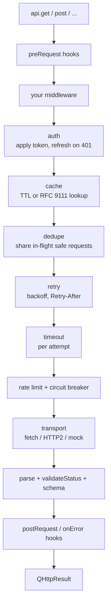

<div align="center">

# qHttp

**One HTTP client for Node, browsers and the edge.**<br>
Retries, caching, auth refresh, rate limits, WebSockets, SSE and React hooks, all composed as middleware over `fetch`.

[](https://www.npmjs.com/package/@questorylabs/qhttp)
[](https://github.com/Questory-Labs/qHttp/actions/workflows/ci.yml)
[](./LICENSE)


[Quick start](#quick-start) ·
[Why qHttp](#why-qhttp) ·
[Features](#features) ·
[Recipes](#recipes) ·
[Entry points](#entry-points) ·
[Docs](#documentation) ·
[FAQ](#faq) ·
[Contributing](#contributing)

</div>

---

```typescript
import { QHttp } from '@questorylabs/qhttp';

const api = new QHttp({ baseUrl: 'https://api.example.com' })
  .setAuth({ type: 'bearer', token: () => session.accessToken, refresh: { run: () => session.refresh() } })
  .setRetry({ retries: 3, backoff: 'exponential', jitter: true })
  .setTimeout(5_000)
  .cache();

const { data } = await api.get<User[]>('/users', { params: { page: 1 } });
```

That is a client with bearer auth, single-flight token refresh on 401, three retries with jittered backoff, a 5 second per-attempt timeout and a 5 minute response cache. Every option can be overridden per call without touching the shared instance.

---

## Table of contents

- [Why qHttp](#why-qhttp)
- [Install](#install)
- [Quick start](#quick-start)
  - [1. Create a client](#1-create-a-client)
  - [2. Make requests](#2-make-requests)
  - [3. Read the result](#3-read-the-result)
  - [4. Handle errors](#4-handle-errors)
- [Features](#features)
- [How it works](#how-it-works)
- [Recipes](#recipes)
  - [Auth with token refresh](#auth-with-token-refresh)
  - [Retries, timeouts and deadlines](#retries-timeouts-and-deadlines)
  - [Caching](#caching)
  - [Validate responses with a schema](#validate-responses-with-a-schema)
  - [Pagination](#pagination)
  - [Rate limiting and circuit breaking](#rate-limiting-and-circuit-breaking)
  - [Middleware and hooks](#middleware-and-hooks)
  - [Upload and download progress](#upload-and-download-progress)
  - [React](#react)
  - [Server-Sent Events](#server-sent-events)
  - [WebSockets](#websockets)
  - [Testing without the network](#testing-without-the-network)
- [Entry points](#entry-points)
- [Documentation](#documentation)
- [Runtime support](#runtime-support)
- [FAQ](#faq)
- [Limitations](#limitations)
- [Contributing](#contributing)
- [License](#license)

---

## Why qHttp

`fetch` is great. Production apps still end up wrapping it with the same things every time: a base URL, auth headers, retries, timeouts, a cache, request logging and a mock for tests. qHttp is that wrapper, done once, as composable middleware.

| You want | With plain `fetch` | With qHttp |
| --- | --- | --- |
| Retry on 503 with backoff | Hand-rolled loop | `.setRetry({ retries: 3 })` |
| Refresh an expired token once, not per request | Mutex you write yourself | `.setAuth({ ..., refresh })` |
| Cache GETs per user | Map keyed by URL, auth leaks | `.cache()` keys include the auth header |
| Validate the JSON you got back | Separate parse step | `{ parse: UserSchema }` |
| Walk a paginated API | `while (next)` loop | `for await (const page of api.paginate(...))` |
| Test without hitting the network | Stub global `fetch` | `new MockAdapter().get('/users/:id', ...)` |
| Server-Sent Events with headers | Not possible with `EventSource` | `new QEventSource(url, { headers })` |

**What it is not.** qHttp is not a re-implementation of `fetch`. It builds the request, runs it through a pipeline, hands it to `fetch` (or an adapter you choose) and parses what comes back. Uncached overhead stays close to native.

**Size.** Measured gzipped, including shared chunks, as of v0.3.0:

| Entry | Gzipped |
| --- | --- |
| `@questorylabs/qhttp` (core) | ~13 KB |
| `/react` | ~8 KB |
| `/sse`, `/ws`, `/testing` | ~2 KB each |

Every entry is tree-shakeable and marked `sideEffects: false`.

---

## Install

```bash
pnpm add @questorylabs/qhttp
# or
npm install @questorylabs/qhttp
# or
yarn add @questorylabs/qhttp
```

Requires **Node 20+** or any runtime with a WHATWG `fetch`. Ships ESM and CJS with full type declarations.

Optional peers, only if you use the matching feature:

| Peer | Needed for | Install |
| --- | --- | --- |
| `react` ≥ 18 | `@questorylabs/qhttp/react` hooks | `pnpm add react` |
| `ws` ^8 | WebSockets on Node | `pnpm add ws` |
| `http-cache-semantics` ^4 | RFC 9111 HTTP cache mode | `pnpm add http-cache-semantics` |

---

## Quick start

### 1. Create a client

A client holds **defaults**. Build one per API and share it across your app. It is safe to use from many places at once.

```typescript
import { QHttp } from '@questorylabs/qhttp';

export const api = new QHttp({ baseUrl: 'https://api.example.com' })
  .setHeaders({ Accept: 'application/json' })
  .setTimeout(10_000);
```

### 2. Make requests

Every verb takes a path and optional **per-call options**. Per-call options override the client's defaults for that one call and never mutate the client.

```typescript
await api.get('/users');
await api.get('/users', { params: { page: 2, limit: 20 } });    // ?page=2&limit=20
await api.post('/users', { body: { name: 'Ada' } });            // JSON, content-type set for you
await api.put('/users/u1', { body: user, timeout: 30_000 });    // longer timeout for this call only
await api.patch('/users/u1', { body: { name: 'B' }, retry: false });
await api.delete('/users/u1');
await api.request({ method: 'POST', url: '/events', body: event });
```

Bodies can be JSON-able objects, strings, `FormData`, `URLSearchParams`, `Blob`, `ArrayBuffer` or a `ReadableStream`.

### 3. Read the result

```typescript
const result = await api.get<User>('/users/u1');

result.data;        // User, parsed from the response
result.httpStatus;  // 200
result.ok;          // true for 2xx
result.headers;     // { 'content-type': 'application/json', ... } lowercase keys
result.fromCache;   // true when served from cache
result.requestId;   // unique id, also attached to errors
result.timing;      // { startedAt, endedAt, durationMs, attempts }
result.response;    // the native Response, when it came from fetch
```

Most of the time you only need `data`:

```typescript
const { data: user } = await api.get<User>('/users/u1');
```

### 4. Handle errors

By default anything outside 2xx throws a `QHttpError` with a stable `code`.

```typescript
import { isQHttpError } from '@questorylabs/qhttp';

try {
  await api.get('/users/missing');
} catch (error) {
  if (isQHttpError(error)) {
    error.code;        // 'HTTP_ERROR' | 'TIMEOUT' | 'NETWORK' | 'VALIDATION_ERROR' | ...
    error.httpStatus;  // 404
    error.data;        // parsed error body from the server, if any
    error.requestId;   // correlate with server logs
  }
}
```

Prefer a result over an exception? Switch it off per call or per client:

```typescript
const result = await api.get('/might-fail', { throwOnError: false });
if (result.error) console.warn(result.error.code, result.httpStatus);
```

Error payloads are redacted. `error.request` never contains the auth config, the request body or raw sensitive headers.

---

## Features

| Area | What you get |
| --- | --- |
| **One client, per-call overrides** | Chainable defaults on the instance, option objects per call, no mutation, safe under concurrency |
| **Middleware pipeline** | Koa-style `use((ctx, next) => ...)`; built-in auth, cache, dedupe, retry, timeout, rate limit and transport are the same kind of step |
| **Auth** | Static or provider tokens (sync or async), basic, custom schemes, single-flight refresh and replay on 401 |
| **Resilience** | Fixed or exponential backoff with equal jitter, `Retry-After`, per-attempt timeout, whole-call deadline, per-origin rate limiter and circuit breaker |
| **Cache** | Opt-in TTL cache with auth-aware keys, or RFC 9111 mode with ETag revalidation and stale-while-revalidate, pluggable engines |
| **Validation** | `parse` accepts any [Standard Schema](https://standardschema.dev) (zod, valibot, arktype) or a function; failures carry `issues` |
| **Pagination** | `paginate()` returns an async iterable with `.items()` and `.all()`; helpers for page numbers, cursors and `Link` headers |
| **Dedupe** | Identical concurrent safe requests share one network call |
| **Progress** | Upload and download byte progress, including `FormData` and streams |
| **Transports** | Fetch with full init passthrough, HTTP/2 on Node, or your own adapter |
| **Realtime** | `QWebSocket` with reconnect, heartbeat and send queue; `QEventSource` with headers, POST bodies, reconnect and `Last-Event-ID` |
| **React** | A small resource store with GC, SSR hydration, `useResource`, `useAction` with optimistic updates, Suspense, paging and live feeds |
| **Testing** | `MockAdapter` with `:param` routes, one-shot replies, delays and recorded calls |
| **Observability** | `requestId`, timing and attempt count on every result and error |

---

## How it works

Every request flows through the same pipeline. Your middleware wraps everything; built-ins run inside it in a fixed order.



Two things fall out of this design:

- **Everything is swappable.** The built-in steps are exported, so you can compose your own pipeline with `compose()`, or replace the transport with `setAdapter()`.
- **Cache hits look like responses.** Your middleware and `postRequest` hooks see cache hits the same way they see network results, with `fromCache: true`.

Read more in [docs/middleware.md](./docs/middleware.md).

---

## Recipes

Copy, paste, adjust. Each recipe links to the full guide.

### Auth with token refresh

```typescript
api.setAuth({
  type: 'bearer',
  token: () => session.accessToken,          // read fresh on every request
  refresh: {
    on: [401],                                // default
    run: async () => {
      await session.refresh();                // concurrent 401s share this one call
      return session.accessToken;
    },
  },
});

await api.get('/public', { auth: false });    // skip auth for one call
```

Also supported: `type: 'basic'` and `type: 'custom'` with an `apply(ctx)` function for signed requests or API keys. [Authentication guide](./docs/authentication.md)

### Retries, timeouts and deadlines

```typescript
api
  .setRetry({ retries: 3, backoff: 'exponential', retryDelay: 300, maxDelay: 30_000, jitter: true })
  .setTimeout(5_000)      // each attempt gets 5s  → TIMEOUT (retryable)
  .setDeadline(20_000);   // the whole call, retries included → DEADLINE
```

By default only idempotent methods retry, on network errors, timeouts and 408 / 425 / 429 / 502 / 503 / 504. `Retry-After` is honoured. Override with `retryOn` or per call with `{ retry: false }`. [Retry & errors guide](./docs/retry-and-errors.md)

### Caching

```typescript
import { MemoryCacheEngine } from '@questorylabs/qhttp';

const cache = new MemoryCacheEngine({ maxSize: 1_000 });
api.cache().cacheTTL(60_000).cacheEngine(cache);

await api.get('/users/u1');                   // network
await api.get('/users/u1');                   // fromCache: true
await api.get('/users/u1', { cache: false }); // bypass once

await cache.deleteByPrefix('GET:https://api.example.com/users');
```

Cache keys hash the `Authorization` header, so two users sharing one engine never see each other's data when that header identifies the user. Cookie-authenticated requests are not told apart: give them a per-user `cacheKey` or a separate engine per user. For servers that send `Cache-Control` and `ETag`, switch to `.httpCache()` and get RFC 9111 freshness, conditional revalidation and stale-while-revalidate. [Caching guide](./docs/caching.md)

### Validate responses with a schema

```typescript
import { z } from 'zod';

const User = z.object({ id: z.string(), name: z.string() });

const { data } = await api.get('/users/u1', { parse: User });
// data is { id: string; name: string }, or the call throws VALIDATION_ERROR with error.issues
```

Works with zod, valibot, arktype or anything that implements Standard Schema. A plain `(raw) => T` function works too. [Requests guide](./docs/requests.md#validation)

### Pagination

```typescript
import { pageParam, cursorParam, linkHeader } from '@questorylabs/qhttp';

const pages = api.paginate<OrdersPage>({
  url: '/orders',
  params: { limit: 50 },
  next: pageParam({ hasMore: (r) => r.data.hasMore }),
  maxPages: 100,
});

for await (const order of pages.items((page) => page.items)) handle(order);

const feed = await api.paginate<Feed>({ url: '/feed', next: cursorParam({ getCursor: (r) => r.data.nextCursor }) }).all();
const repos = await api.paginate<Repo[]>({ url: '/repos', next: linkHeader() }).all(); // GitHub-style Link headers
```

[Requests guide](./docs/requests.md#pagination)

### Rate limiting and circuit breaking

```typescript
import { RateLimiter, CircuitBreaker } from '@questorylabs/qhttp';

const limiter = new RateLimiter({ requestsPerSecond: 10, burst: 20, concurrency: 4 });
const breaker = new CircuitBreaker({ failureThreshold: 5, resetAfterMs: 30_000 });

tmdb.rateLimit(limiter).circuitBreaker(breaker);
trakt.rateLimit(limiter);   // share one budget across clients
```

Both are per origin. When the breaker is open, calls fail fast with `CIRCUIT_OPEN` instead of waiting on a dead upstream. [Retry & errors guide](./docs/retry-and-errors.md#rate-limiting)

### Middleware and hooks

```typescript
// Wrap the whole call
api.use(async (ctx, next) => {
  const started = performance.now();
  try {
    return await next();
  } finally {
    log(ctx.method, ctx.resolvedUrl, Math.round(performance.now() - started), ctx.requestId);
  }
});

// Or hook into one phase
api.preRequest((ctx) => {
  ctx.headers.set('x-request-id', ctx.requestId);
});
api.postRequest(({ result }) => metrics.observe(result.timing.durationMs));
api.onRetry(({ attempt, error }) => log.warn('retry', attempt, isQHttpError(error) ? error.code : error));
```

[Middleware guide](./docs/middleware.md) · [Hooks guide](./docs/hooks.md)

### Upload and download progress

```typescript
await api.post('/upload', {
  body: formData,
  onProgress: (e) => {
    if (e.direction === 'upload') setPercent((e.loaded / (e.total ?? 1)) * 100);
  },
});
```

[Requests guide](./docs/requests.md#progress)

### React

```tsx
import { ResourceProvider, useResource, useAction } from '@questorylabs/qhttp/react';

<ResourceProvider defaults={{ freshFor: 30_000 }}>
  <App />
</ResourceProvider>;

function Profile({ userId }: { userId: string }) {
  const user = useResource({
    id: ['user', userId],
    load: () => api.get<User>(`/users/${userId}`).then((r) => r.data),
    refreshOnFocus: true,
    keepPrevious: true,
  });

  const rename = useAction({
    run: (name: string) => api.patch('/me', { body: { name } }).then((r) => r.data),
    optimistic: (name) => [[['user', userId], (prev) => ({ ...(prev as User), name })]],
    touches: [['user', userId], ['dashboard']],
  });

  if (user.failed) return <ErrorView error={user.error} />;
  if (!user.value) return <Spinner />;
  return <Editor value={user.value} onSave={rename.submit} busy={rename.busy} />;
}
```

Also available: `useSuspenseResource`, `usePagedResource` for infinite lists, and `useLiveResource` for an initial load plus pushes from SSE or WebSockets. The underlying `ResourceStore` works without React and supports `dehydrate()` / `hydrate()` for SSR. [React guide](./docs/react.md)

### Server-Sent Events

Unlike the browser `EventSource`, this one supports custom headers, credentials, POST bodies, Node and reconnect with `Last-Event-ID`.

```typescript
import { QEventSource } from '@questorylabs/qhttp/sse';

const stream = new QEventSource('https://api.example.com/stream', {
  headers: { authorization: `Bearer ${token}` },
  reconnect: { retries: 10, delay: 1_000, backoff: 'exponential', jitter: true },
})
  .onJson<Tick>((tick) => update(tick), 'tick')
  .onStateChange((state) => setStatus(state))
  .connect();

// or iterate
const source = new QEventSource(url);
try {
  for await (const message of source) {
    if (message.event === 'done') break;
  }
} finally {
  source.close();
}
```

[SSE guide](./docs/sse.md)

### WebSockets

```typescript
import { QWebSocket } from '@questorylabs/qhttp/ws';

const socket = new QWebSocket('wss://example.com/socket')
  .setReconnect({ retries: 5, delay: 1_000, backoff: 'exponential', jitter: true })
  .setHeartbeat({ intervalMs: 30_000, message: 'ping', isPong: 'pong', pongTimeoutMs: 5_000 })
  .onJson<ServerEvent>((event) => handle(event))
  .onReconnected(() => socket.sendJson({ type: 'subscribe', channel: 'orders' }))
  .connect();

socket.sendJson({ type: 'subscribe', channel: 'orders' }); // queued until open
```

On Node, pass `await NodeWSAdapter.create()` to `setAdapter()` (needs the `ws` peer). [WebSockets guide](./docs/websockets.md)

### Testing without the network

```typescript
import { QHttp } from '@questorylabs/qhttp';
import { MockAdapter } from '@questorylabs/qhttp/testing';

const mock = new MockAdapter()
  .get('/users/:id', (_req, { params }) => ({ body: { id: params.id, name: 'Ada' } }))
  .post('/users', async (_req, { body }) => ({ status: 201, body: await body() }))
  .once('GET', '/flaky', { status: 503 });   // first call only, then falls through

const api = new QHttp({ adapter: mock, baseUrl: 'https://api.test' }).setRetry({ retries: 1 });

const { data, timing } = await api.get<User>('/users/42');
expect(data.id).toBe('42');
expect(mock.callsTo('GET', '/users/:id')).toHaveLength(1);
```

[Testing guide](./docs/testing.md)

---

## Entry points

Import only what you use. Each path is its own bundle.

| Import | Contents |
| --- | --- |
| `@questorylabs/qhttp` | `QHttp`, `QHttpError`, middleware factories, `MemoryCacheEngine`, `LocalStorageCacheEngine`, `RateLimiter`, `CircuitBreaker`, pagination helpers, `FetchAdapter` |
| `@questorylabs/qhttp/react` | `ResourceProvider`, `useResource`, `useAction`, `useLiveResource`, `useSuspenseResource`, `usePagedResource` |
| `@questorylabs/qhttp/resource` | Framework-agnostic `ResourceStore` |
| `@questorylabs/qhttp/sse` | `QEventSource`, `subscribeSse`, `createSseParser` |
| `@questorylabs/qhttp/ws` | `QWebSocket`, `BrowserWSAdapter`, `NodeWSAdapter` |
| `@questorylabs/qhttp/http2` | `Http2Adapter` for Node |
| `@questorylabs/qhttp/http-cache` | RFC 9111 policy helpers |
| `@questorylabs/qhttp/testing` | `MockAdapter`, `mockResponse` |

---

## Documentation

Full guides live in [docs/](./docs/README.md). Suggested reading order for newcomers:

| # | Guide | Covers |
| --- | --- | --- |
| 1 | [Getting started](./docs/getting-started.md) | Clients, per-call options, the result object, cancel and reset |
| 2 | [Requests](./docs/requests.md) | URLs and macros, params, bodies, response types, validation, progress, pagination |
| 3 | [Retry & errors](./docs/retry-and-errors.md) | Backoff, deadline, rate limit, circuit breaker, every error code |
| 4 | [Authentication](./docs/authentication.md) | Bearer providers, refresh, basic, custom schemes |
| 5 | [Caching](./docs/caching.md) | TTL vs HTTP mode, keys, engines, invalidation |
| 6 | [Middleware](./docs/middleware.md) | Pipeline order, writing middleware, built-ins as building blocks |
| 7 | [Hooks](./docs/hooks.md) | `preRequest`, `postRequest`, `onError`, `onRetry`, custom phases |
| 8 | [Adapters](./docs/adapters.md) | Fetch options, HTTP/2, custom transports |
| 9 | [React](./docs/react.md) | `ResourceStore`, hooks, Suspense, SSR |
| 10 | [SSE](./docs/sse.md) | `QEventSource`, reconnect, async iteration |
| 11 | [WebSockets](./docs/websockets.md) | Reconnect, heartbeat, Node adapter |
| 12 | [Testing](./docs/testing.md) | `MockAdapter` and `mockResponse` |
| 13 | [API reference](./docs/api-reference.md) | Every method, option and type on one page |

Release notes are in [CHANGELOG.md](./CHANGELOG.md).

---

## Runtime support

| Runtime | Status | Notes |
| --- | --- | --- |
| Node 20, 22, 24 | Tested in CI | Native `fetch`. Optional `ws` and HTTP/2 adapter |
| Browsers | Supported | `LocalStorageCacheEngine` available. Browser WebSockets cannot send custom headers |
| Edge (Cloudflare Workers, Vercel Edge, Deno, Bun) | Supported | Anything with WHATWG `fetch`, `AbortController` and `ReadableStream` |
| React 18, 19 | Supported | Hooks entry only |

---

## FAQ

**Is this a replacement for axios or ky?**
It covers the same ground for requests, and adds caching, auth refresh, rate limiting, pagination, SSE, WebSockets and React hooks under one middleware model. If you only need a thin `fetch` wrapper, ky is smaller. If you need the rest, this saves gluing five libraries together.

**Is the React layer a TanStack Query replacement?**
It is deliberately smaller: ids, loads, freshness, invalidation, push, optimistic actions and a few hooks. If you need devtools, persisters or a large plugin ecosystem, use TanStack Query. If you want something that fits in 8 KB and shares the HTTP client's auth and retries, this is it.

**Does `.cache()` leak data between users?**
Not when the `Authorization` header identifies the user: the default key hashes it. Cookie-authenticated requests are not told apart, so use a per-user `cacheKey` or a separate engine per user. If you set an explicit `cacheKey`, include the user yourself.

**What happens if I call `setRetry` on a client and use `retries` in `useResource`?**
Both layers retry independently. Keep one owner; the docs recommend the HTTP client.

**Can I use it with CommonJS?**
Yes. Every entry ships `.cjs` and `.d.cts` builds. `require('@questorylabs/qhttp')` works.

**Does it work with a custom `fetch` like undici?**
Yes. `new FetchAdapter({ fetch: undici.fetch })`, or pass a `dispatcher` through `setFetchOptions()`.

**How do I cancel a request?**
Pass an `AbortSignal` per call, or call `api.cancel()` to abort everything in flight on that client.

---

## Limitations

- No HTTP/3 adapter in core. Use `.setAdapter()` for custom transports.
- `Http2Adapter` rejects `FormData` and `ReadableStream` bodies and buffers responses. Use the fetch adapter for upload progress and streaming.
- `FormData` upload `total` is estimated from field sizes. Opaque streams only report `total` when `Content-Length` is set.
- In-memory cache and resource store do not survive serverless cold starts.
- HTTP cache mode requires `http-cache-semantics` and stores one variant per key. Use explicit keys for multiple `Vary` representations.
- `client.fetchStatus` reflects the most recent transition on the instance. With concurrent calls use `result.fetchStatus` and `client.inFlight`.

---

## Contributing

```bash
git clone https://github.com/Questory-Labs/qHttp.git
cd qHttp
pnpm install

pnpm test            # vitest
pnpm test:coverage   # with v8 coverage
pnpm typecheck       # tsc --noEmit
pnpm lint            # eslint
pnpm build           # tsup → dist/
pnpm size            # size-limit budgets per entry
pnpm check           # everything CI runs
pnpm bench           # vitest benchmarks
```

Project layout:

```
src/
├── core/         QHttp class, request building, pipeline, pagination, result
├── middleware/   auth, cache, dedupe, retry, timeout, rate-limit, transport
├── adapters/     fetch and HTTP/2 transports
├── cache/        engines, keys, RFC 9111 policy
├── auth/         token resolution and application
├── errors/       QHttpError and redaction
├── resource/     framework-agnostic ResourceStore
├── react/        hooks and provider
├── sse/          QEventSource and parser
├── ws/           QWebSocket and adapters
└── testing/      MockAdapter
test/             mirrors src/, plus bench/
docs/             guides
```

CI runs on Node 20, 22 and 24 and checks types, lint, tests, build, size budgets and package exports (`publint` + `arethetypeswrong`). Pull requests welcome.

---

## License

[MIT](./LICENSE) © Questory Labs
